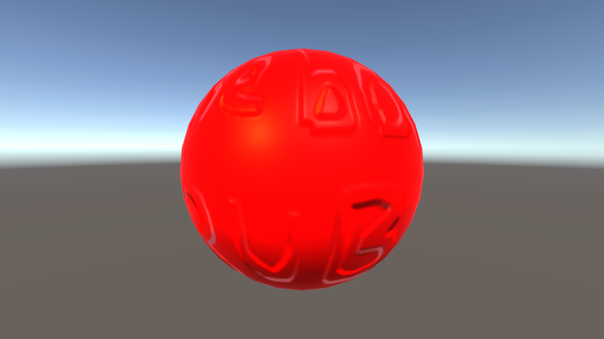
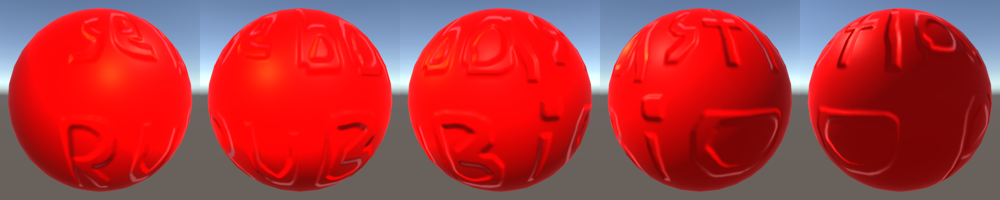
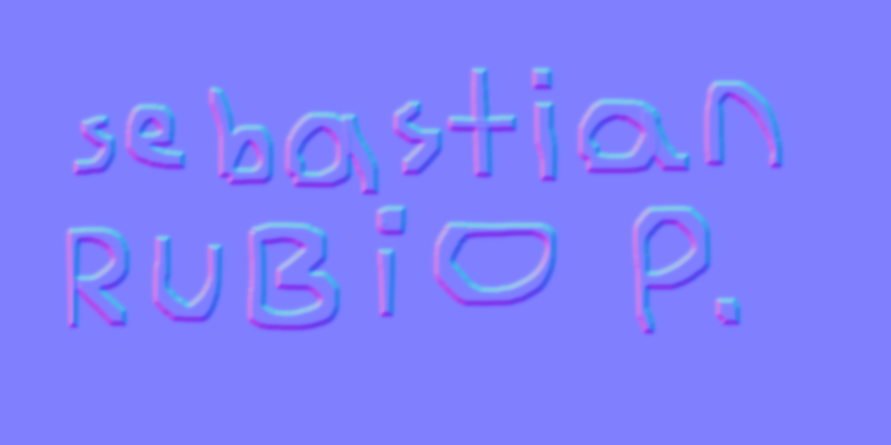

# Esfera con mapa normal

Esfera con un material que usa un mapa normal con mi nombre (hecho en GIMP), una Point Light y color rojo.

El nombre da la vuelta a la esfera; girándola se lee "sebastian RUBIO P.":

Mapa normal usado:

## Commits

1. creando esfera
2. texturizando esfera
3. agregando luz
4. coloreando esfera de rojo
